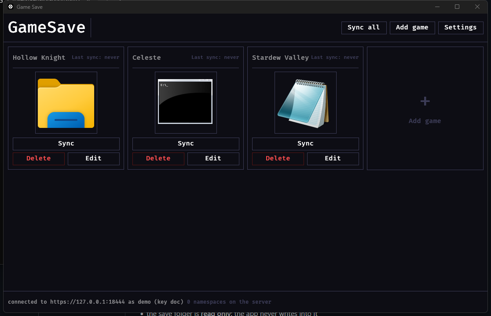

# Game Save

[](https://github.com/regalf/game-save/actions/workflows/ci.yml)

Self-hosted cloud save for the games that have none.

Game Save is a small Go server that stores your game saves, and a companion
desktop app that watches your games and keeps the saves in sync between
machines. It is built for a homelab: one binary, one SQLite file, one blob
directory, no external service, no account, no telemetry.



---

## Who it is for

| Game | What to use |
|---|---|
| A game that integrates the Steam Cloud SDK | **Steam Cloud.** It is already integrated, it is what the developer tested. |
| A game from GOG, Epic or itch.io | **Game Save.** Those stores have no cloud save at all, the saves live in a folder on disk and are lost with the machine. |
| An indie game on Steam that does not use the Steam Cloud SDK | **Game Save.** Being on Steam does not mean the save is in the cloud: the SDK has to be part of the game. |

Game Save covers the gap Steam Cloud leaves. It does not compete with it.

---

## How it works

You tell the app which executable is the game and which folder holds its
saves. The app notices when the game starts and when it stops, and at the end
of every session it reads the save folder, compares it with what the server
holds, and uploads what is new or changed.

**Your save files are never written to.** The app only reads them. The only
thing it writes is its own state, in its own directory.

Nothing is ever overwritten silently: an upload tells the server which version
it believes is there, and the server answers `409 Conflict` when that is not
true. When both sides changed, you choose which one wins.

---

## Quick start

```bash
cd server
go build -o gamesave ./cmd/gamesave
./gamesave user add alice
./gamesave key create --user alice --label laptop   # shown once
./gamesave serve --config config.yaml
```

The server generates its own certificate authority at the first start and
prints the fingerprint. The client pins that fingerprint and trusts nothing
else, so a server whose authority changed simply stops working.

To run the companion app, open it, paste the URL, the fingerprint and an API
key, and add your first game. Everything else happens on its own.

---

## Read more

| Document | What it holds |
|---|---|
| [docs/ARCHITECTURE.md](docs/ARCHITECTURE.md) | the two halves, the data model, the layout on disk, the configuration |
| [docs/CLIENT.md](docs/CLIENT.md) | the interface, the cards, the panels, the session, the icons |
| [docs/PROTOCOL.md](docs/PROTOCOL.md) | the API and how the synchronisation decides what to transfer |
| [docs/DEPLOY.md](docs/DEPLOY.md) | systemd, Docker, backups, how to reach it from outside |
| [SECURITY.md](SECURITY.md) | what the program is built to withstand, and what it is not |
| [CONTRIBUTING.md](CONTRIBUTING.md) | the rules for who wants to help |
| [CODE_OF_CONDUCT.md](CODE_OF_CONDUCT.md) | how to behave with each other |

The API is described in [spec/openapi.yaml](spec/openapi.yaml).

---

## Status

| Component | State |
|---|---|
| `server/` — Go server, API, CLI, TLS, Docker | done |
| `desktop/` — Rust companion app (egui) | done |
| E2E encryption | planned, opt-in per user |
| Chunk level delta upload | planned |
| Session watcher on Windows | planned, Linux only today |

---

## Licence

Game Save is released under the GNU General Public License v3.0. See
[LICENSE](LICENSE) for the full text. The interface font is Fira Code, under
the SIL Open Font License, which is compatible with the GPL.
